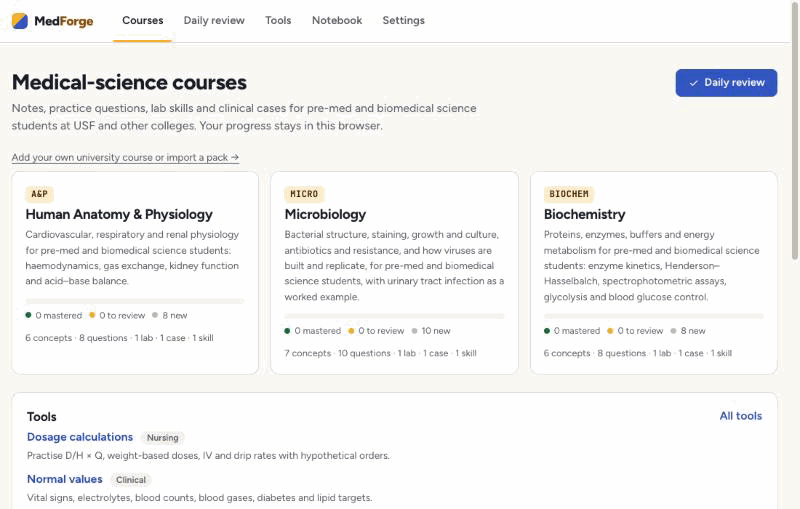
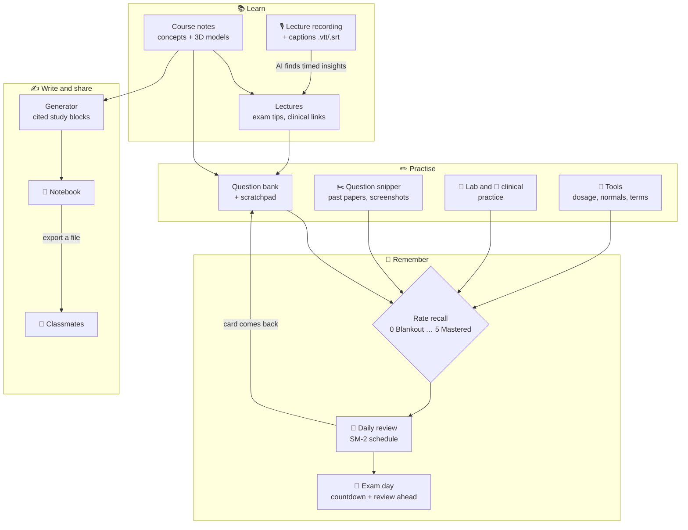
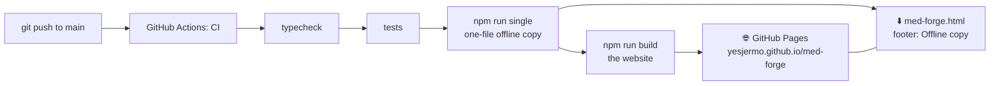
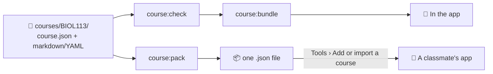
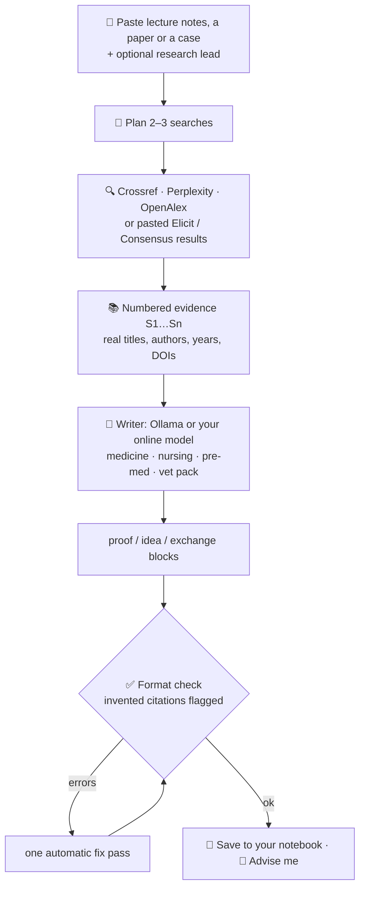
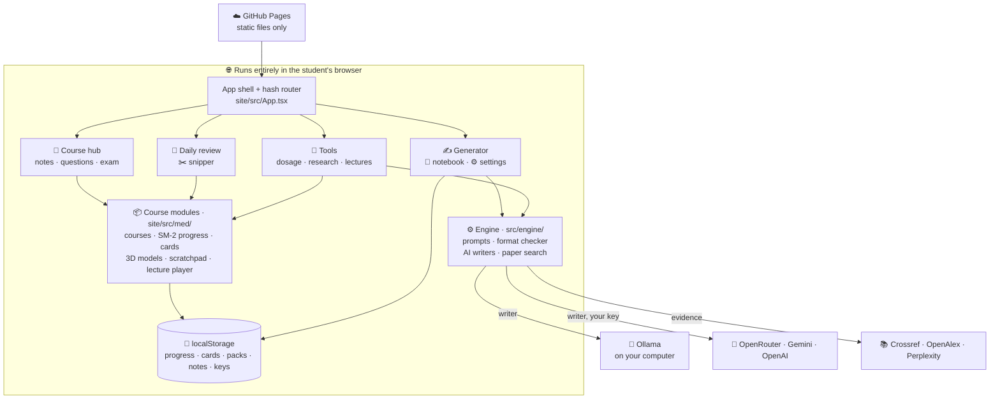
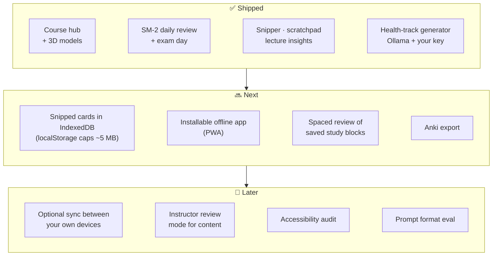

<div align="center">

# 🩺 MedForge

**Course notes, practice questions, lab and clinical practice, and cited study blocks for medical, nursing, pre-med and pre-vet students.**

[](https://github.com/yesjermo/med-forge/actions/workflows/ci.yml)
[](https://yesjermo.github.io/med-forge/)
[](https://yesjermo.github.io/med-forge/med-forge.html)
[](LICENSE)
[](https://github.com/yesjermo/med-forge/commits/main)

[](https://nodejs.org)
[](https://www.typescriptlang.org)
[](https://react.dev)
[](https://vite.dev)
[](https://vitest.dev)
[-000000?logo=ollama&logoColor=white)](https://ollama.com)
[](#-run-it)

**[Open MedForge →](https://yesjermo.github.io/med-forge/)**



</div>

A study site for **medical-science undergraduates** (pre-med, biomedical science, nursing pathways) at USF and other colleges: course notes, a question bank with spaced review, **lab practice** and **clinical practice**, all running in your browser. Inspired by the method of [NoobChester/course-noting](https://github.com/NoobChester/course-noting); all content is original. Not affiliated with or endorsed by any university or institution.

## ⚡ Quickstart (on your own computer)

Run MedForge locally and add your university courses privately. You need [Node.js](https://nodejs.org) 22.13+ and, for the free AI writer, [Ollama](https://ollama.com).

**1. Clone and install**

```bash
git clone https://github.com/yesjermo/med-forge.git
cd med-forge
npm install
```

**2. Start it**

```bash
npm run dev
```

Open http://localhost:5173/med-forge/. Pick a free AI model in **Settings** (or straight on the generator page): MedForge lists the models installed in Ollama and the free ones you can download, e.g. `ollama pull qwen3`.

**3. Add your own course** (kept off GitHub: `courses/` is git-ignored)

```bash
npm run course:new -- BIOL105 "Molecules of Life"
```

```
courses/BIOL105/
├── course.json     # code, title, topics
├── concepts/       # theory notes (.md with KaTeX, optional 3D model)
├── questions/      # question cards (.md with prompt, answer, hints)
├── lectures/       # lecture notes (.md with insights, chapters, audio link)
├── labs/ cases/ skills/   # practice (.yaml)
└── README.md       # the format, in full
```

**4. Turn lecture captions into notes** (Echo360, Panopto, Kaltura: download the captions yourself; MedForge never logs in)

```bash
npm run course:lecture -- BIOL105 week3.vtt --title "Week 3: Enzymes"
```

**5. Check and bundle your courses into the app**

```bash
npm run course:check && npm run course:bundle
```

### 💾 Save, load and move between devices

Your progress lives in your browser. **Save / Load** in the top bar:

1. **Copy save string**: one compressed line with your progress, answers, SM-2 schedules, notebook, imported packs, exam date and scratchpads. Paste it on another device to carry on.
2. **Download backup file** (`med-forge-backup-<date>.json`), optionally with your snipped cards.
3. **Load**: paste a string or upload a file, see what's in it, then merge it with what's there or replace it.
4. **Clean slate for sharing**: clears your answers and progress but keeps the courses and imported packs, so you can hand the browser or your course packs to a friend.

Settings and API keys are never included in a save string or backup file.

## 🧩 Course packs (.json): get one or make one

A **course pack** is one `.json` file that holds a whole course: its notes, lectures, questions, labs, cases and skills. It's how a course moves between people and onto the website. Inside, it looks like this:

```json
{
  "format": "study-forge-course",
  "version": 1,
  "course": {
    "id": "biol-105", "code": "BIOL 105", "title": "Molecules of Life",
    "description": "…", "topics": ["Chemistry of life", "Macromolecules"],
    "concepts": [ … ], "lectures": [ … ], "questions": [ … ],
    "labs": [ … ], "cases": [ … ], "skills": [ … ]
  }
}
```

You don't write this JSON by hand. You either export it from the app, or write a course folder of simple Markdown files and let `npm run course:pack` convert the folder to `.json`.

### Get a pack

- **From the app:** **Tools › Add or import a course**, then **Export pack** next to any course, built-in ones included. The file downloads as `<course-id>.med-forge-pack.json`.
- **From a classmate:** they export or pack their course and send you the `.json` file.
- **From the website's repo:** packs anyone published are in [`site/src/med/published/`](site/src/med/published/).

The built-in courses are already in the app, so importing one of their packs is refused as a duplicate. To make your own version of a built-in course, unpack its pack (below) and edit it.

### Make a pack from your own notes

You need the project on your computer (see **Run it locally**).

1. **Start a course folder**:
   ```bash
   npm run course:new -- BIOL105 "Molecules of Life"
   ```
   This creates `courses/BIOL105/` with example files to replace, and a `README.md` describing every field. The folder is git-ignored, so it never leaves your computer.
2. **Put your notes into the files.** Open `courses/BIOL105/` in any editor (VS Code works well):
   - `course.json`: the code, title, description and `topics` (your course's modules)
   - `concepts/<name>.md`: one page per key idea, with a front-matter header (`title`, `topic`, `summary`, `pearls`, optional `formulas` and `model`) and your notes below it
   - `lectures/<name>.md`: one per lecture, with `week`, `title`, `topic`, `summary`, `insights` (exam tips, clinical links, intuitions)
   - `questions/<id>.md`: one per question, multiple choice (`options`, `answer`) or numeric (`answer`, `tolerance`, `unit`), with the prompt, then `<!-- split:hints -->` and `<!-- split:explanation -->`
   - `labs/`, `cases/`, `skills/`: `.yaml` files, copied from the examples

   For a complete working course, copy [`courses.example/MEDS101`](courses.example/MEDS101) (`cp -r courses.example/MEDS101 courses/MEDS101`) and compare.

   A question file looks like this:
   ```markdown
   ---
   id: biol105-q1
   type: numeric
   topic: Chemistry of life
   difficulty: 1
   concepts: [water-and-ph]
   answer: 7.4
   tolerance: 0.05
   unit: ""
   ---

   What is the pH of a solution with [H⁺] = 4.0 × 10⁻⁸ mol/L?

   <!-- split:hints -->

   - pH = −log₁₀[H⁺]

   <!-- split:explanation -->

   pH = −log₁₀(4.0 × 10⁻⁸) = 7.40.
   ```
3. **Lecture recordings and captions** (optional): turn captions you downloaded from Echo360, Panopto or Kaltura into a lecture file:
   ```bash
   npm run course:lecture -- BIOL105 week3.vtt --title "Week 3: Enzymes"
   ```
4. **Check it.** Every problem is reported with its file name:
   ```bash
   npm run course:check
   ```
   A pack needs at least 4 concepts, 6 questions, 2 lectures, 1 lab, 1 case and 1 skill; every `topic` must be listed in `course.json`; and ids must be unique.
5. **Convert the folder to `.json`:**
   ```bash
   npm run course:pack -- BIOL105
   ```
   This writes `biol-105.med-forge-pack.json` (named after the course id) in the project folder. Give a second argument to choose the file name: `npm run course:pack -- BIOL105 ~/Desktop/biol105.json`.

Then use the `.json`: import it on the website (**Tools › Add or import a course › Import a course pack (.json)**), send it to a classmate, or publish it for everyone (see **Add courses, images and recordings**).

### Turn a pack back into editable files

```bash
npm run course:unpack -- biol-105.med-forge-pack.json
```

This writes `courses/<CODE>/`, named from the course code, or pass a folder name as a second argument. It never overwrites a folder that already exists. Edit the files, then `course:check` and `course:pack` again. A copy of a built-in course gets its own course id and item ids, and "(my copy)" in its title, so it doesn't clash with the original or share its progress.

### Let an AI draft the files from your notes (optional)

Paste the prompt below into an AI chat (for example `ollama run qwen3` on your own computer, which is free), followed by your own lecture notes. Save each file it writes into your course folder under the path after `FILE:`, change the concept slugs and question ids to suit your course, then run `npm run course:check` and fix whatever it reports. Small local models often stop early or repeat a file name; ask them to continue ("write 2 more questions"), or use a larger model (`qwen3`, or an online one in **Settings**). AI drafts make mistakes, so check every fact and answer against your course materials.

```text
Convert my lecture notes into MedForge course files. Use only facts from my notes.
Write each file in full, starting with a line "FILE: <path>". No headings, no ``` fences.
Every topic must be one of: <paste the topics from course.json>.
Write 4 concept files and 8 question files, exactly in these formats. The names below are
examples only: give every concept its own file name and slug (e.g. concepts/protein-structure.md)
and number the questions biol105-q1, biol105-q2, and so on.

FILE: concepts/water-and-ph.md
---
title: Water and pH
topic: Chemistry of life
summary: One sentence that sums up the idea.
pearls:
  - "Acidosis below pH 7.35 can cause confusion and arrhythmias."
  - "Hyperventilation blows off CO2 and causes respiratory alkalosis."
---
The explanation in Markdown. Use $...$ for maths, e.g. $pH = -\log_{10}[H^+]$.

FILE: questions/biol105-q1.md
---
id: biol105-q1
type: mcq
topic: Chemistry of life
difficulty: 1
concepts: [water-and-ph]
options:
  - The first answer, written out in full
  - The second answer
  - The third answer
  - The fourth answer
answer: 1
---
The question text.

<!-- split:hints -->

- A first hint.
- A second hint.

<!-- split:explanation -->

Why the right answer is right.

(Put any line that contains a colon in "double quotes". A numeric question uses
"type: numeric" and, instead of options, "answer: 7.4",
"tolerance: 0.05" and "unit: mmHg". "answer" in an mcq is the 0-based index of the right option.)

My notes:
```

## 📤 Add courses, images and recordings

There are two ways to add your own material: **in your browser** on the live website (only you see it), or **published** with the website so everyone who opens it sees it.

### In your browser, on the live website (no install)

Open https://yesjermo.github.io/med-forge/. Everything you add this way stays in your browser; nothing is uploaded anywhere. Use **Save / Load** to move it to another device.

| You have | Where to add it | What happens |
|---|---|---|
| A course pack (`.json`) | **Tools › Add or import a course › Import a course pack (.json)** | The course appears on the home page with its notes, questions, labs and cases. Packs come from `npm run course:pack`, a classmate, or **Export pack** on that same page |
| A photo or screenshot (`.jpg`, `.png`, …) or a PDF of a past paper | **Tools › Question snipper**: choose the file, drag it in, or paste a screenshot | Drag a box around a problem (and its answer); it becomes a card in your **Daily review**. PDFs work on the website; the one-file offline copy takes images only |
| A lecture recording (`.mp4`, `.m4a`, `.mp3`, `.webm`, …) | Open any lecture › **Add a recording** › pick the file | It plays with the lecture's chapters and insights alongside. An `.mp4` plays its sound. The file stays on your computer, so pick it again next visit |
| Lecture captions (`.vtt`, `.srt`, `.txt`, e.g. exported from Echo360) | **Tools › Lecture recording to insights** | The AI finds timed exam tips; save them as a lecture in a course you imported, or download the lecture file for a course folder |
| A backup or save string | **Save / Load** | Restores your progress, notebook, packs and scratchpads (merge or replace) |

### Published, so everyone sees it (through GitHub)

Anything committed to the repo is built into the website by the CI workflow on every push to `main` (about a minute).

1. **Course packs:** put the `.json` file in **`site/src/med/published/`**. Either run `npm run course:bundle -- --publish` to write your course folders there, or drop in a pack you exported from the app (**Export pack**) or made with `npm run course:pack`. Without a computer: on GitHub, open the `site/src/med/published` folder, choose **Add file › Upload files**, drop the `.json` in and commit.
2. **Lecture recordings:** put the file in **`site/public/media/`** and point the lecture at it in its front matter with `audio: media/week3.m4a` (or `--audio media/week3.m4a` with `npm run course:lecture`). A link to a recording hosted elsewhere (`audio: https://…`) also works and keeps the repo small.
3. Commit and push (or commit on GitHub). When the **CI** run on the **Actions** tab is green, reload the website.

Limits and rules:
- GitHub refuses files over 100 MB and warns above 50 MB, and a GitHub Pages site can be at most 1 GB. Prefer short, audio-only `.m4a` or `.mp3` files; for long lectures, link to a recording hosted elsewhere.
- Published files are public. Only publish what you wrote yourself or have permission to share: not your university's slides, exam papers or lecture recordings. Keep those in the private `courses/` folder, which is never uploaded.

## 🧭 Workflow map

How the pieces fit into a study week. Everything runs in your browser; the only things that leave it are the AI requests you choose to make (to Ollama on your own computer, or to a provider you add a key for) and paper searches.



<details>
<summary>🛠️ How a change gets to the live site</summary>



</details>

## 🏥 Medical-science course hub


Eight courses: three general ones (**Human Anatomy & Physiology**, **Microbiology**, **Biochemistry**) and five aligned with University of San Francisco courses: **BIOL 105 Molecules of Life**, **BIOL 106 Diversity of Life**, **CHEM 111 General Chemistry I**, **NURS 220 Applied Pathophysiology & Pharmacology I** and **NURS 222 Applied Assessment & Nursing Fundamentals**. The USF course codes and titles come from USF's own advising pages; the content is original and covers topics typical for each course, so check it against your syllabus. MedForge isn't affiliated with or endorsed by USF. Inside a course, a **course bar** under the main menu switches between courses, jumps to the dashboard, questions, concepts, lectures, timed exam and revision sheet, shows how many questions you've mastered, turns **lecture insights** on or off (what the lectures said about a concept, shown on its page and after you answer a question), and **Practice** jumps to the next question worth doing. The **Guide** in the main menu walks through every part of MedForge. Each course has:

- **Concepts:** key ideas with formulas and clinical pearls, many with an interactive **3D model** (DNA, α-helix, haemoglobin, an enzyme–substrate complex, glucose, a sarcomere, a bacterium, a cell membrane and more) that you can drag or turn with the arrow keys
- **Lectures:** notes with exam tips, clinical links and intuitions
- **Question bank:** multiple-choice and numeric questions with hints and explanations, and a **Scratchpad** tab on every question (pen, highlighter, eraser, colours, undo; saved with the question) for sketches and side calculations. There's also a **timed exam** and a printable **revision sheet**.
- **Daily review** (`#/daily-review`): built-in SuperMemo-2 (SM-2) spaced repetition. Rate recall from 0 (Blankout) to 5 (Mastered 🎉) and each card comes back just before you'd forget it. Set your exam day to see a countdown and review ahead everything due before it.
- **Question snipper** (`#/import`): open a past exam or tutorial sheet, drag a box over a problem (and its answer, if you like), and it becomes a card in your daily review. PDFs open in the hosted site; the double-click `web/index.html` takes images and screenshots, which keeps it small. Files never leave your browser.
- **Lecture recordings:** add a recording to any lecture and play it with chapters and timed insights that follow along (the player streams with HTTP range requests, so a long recording isn't downloaded in full). **Tools > Lecture recording to insights** turns a lecture's captions into timed exam tips, clinical links and intuitions with your AI writer. Echo360 needs your university login, so export the captions (`.vtt`/`.srt`/`.txt`) and audio from Echo360, or use a direct media link; MedForge never logs in anywhere.
- **Lab practice:** a protocol with safety notes and a tickable checklist, calculation drills that check your answer, and **lab calculators** (C₁V₁ = C₂V₂, solute mass, plate counts, hemocytometer, Beer–Lambert, Henderson–Hasselbalch)
- **Clinical practice:** a staged patient case (history → exam → tests → interpretation → diagnosis → management principles) with feedback and a score, plus an OSCE-style skill checklist with critical steps

<br clear="right">

> [!NOTE]
> For learning only, not medical advice. Cases are educational simulations with fictional patients and contain no drug doses.

### 🏫 Add your own university course

Like [course-noting](https://github.com/NoobChester/course-noting), each course is a folder of plain files you can write in any editor. `courses/` is git-ignored, so your notes stay on your computer.

```bash
npm run course:new -- BIOL113 "Human Anatomy"   # make courses/BIOL113/ with starter files
npm run course:lecture -- BIOL113 week3.vtt     # lecture notes + AI insights from captions you downloaded
npm run course:check                            # find problems, with the file name
npm run course:bundle                           # add every course in courses/ to the web app
npm run course:pack -- BIOL113                  # one file to send to a classmate
npm run course:unpack -- pack.json              # a pack back into an editable folder
```



A course folder has `course.json` plus `concepts/*.md` (add `model: dna`, `bilayer`, `virus`… to show a 3D model), `lectures/*.md`, `questions/*.md` (markdown with YAML front matter) and `labs/`, `cases/`, `skills/*.yaml`. Copy `courses.example/MEDS101` to see a complete one. In the app, **Tools > Add or import a course** imports a classmate's pack, and exports or removes the ones you've added. Imported courses live in your browser only.

For Echo360 (or Panopto, Kaltura) lectures, download the captions yourself from the lecture page, then `npm run course:lecture -- BIOL113 captions.vtt --title "Week 3: Joints"` writes `lectures/<id>.md` with timestamped notes, chapters and exam tips (free local Ollama by default, `--no-ai` for notes only, `--audio <https link>` if you have a direct link to the recording). MedForge never logs in to Echo360.

### 🧰 Tools for medical, nursing and research students

Under **Tools** in the nav:

- **Dosage calculations:** D/H × Q, weight-based doses, IV pump and gravity drip rates, infusion time, with practice problems that check your answer
- **Normal values:** vital signs, electrolytes, blood counts, blood gases, glucose and lipid targets, searchable
- **Medical terminology:** 99 prefixes, roots and suffixes as flashcards with spaced review
- **Lab calculators:** dilutions, solute mass, plate counts, hemocytometer, Beer–Lambert, pH
- **Research toolkit:** turn a PICO question into a PubMed search, 2×2 statistics (sensitivity, specificity, LRs, RR, OR, NNT with 95% CIs), an evidence and appraisal guide, and AMA/APA citations from a DOI (looked up on Crossref)

Reference ranges vary between labs and textbooks; use your course's values in exams and clinical placements.

> [!IMPORTANT]
> **Current status: runs locally, no paid API keys yet.**
> - Study blocks are written by a **local model through [Ollama](https://ollama.com)** on your own computer (free and offline). Stronger models are optional: see **Choosing the AI model** below.
> - Papers are found with **Crossref**, a free scholarly index that needs no key.
> - **Perplexity, Elicit and Consensus are used manually in your own browser for now.** Search on perplexity.ai, elicit.com or consensus.app, then paste the answer, links or an exported list into the "Paste results" box. MedForge picks out the DOIs and links and cites them.
> - The code that calls the Perplexity, Elicit, Consensus, OpenRouter, Gemini and OpenAI APIs directly is already written (from their public docs) and switches on as soon as you add a key in Settings (or in `.env` for the command-line tool). It has only been tested with mocked responses so far, not against the live services.

## 🚀 Run it

MedForge runs entirely in the browser: no server, no account. Progress, notes and keys stay on your device.

### 💻 Run it locally

You need [Node.js](https://nodejs.org) 22.13 or newer (check with `node -v`) and, for the free AI writer, [Ollama](https://ollama.com).

1. Get the code and install it (once):
   ```bash
   git clone https://github.com/yesjermo/med-forge.git
   cd med-forge
   npm install
   ```
2. Start the development server:
   ```bash
   npm run dev
   ```
3. Open http://localhost:5173/med-forge/. Changes to the code reload the page by themselves. Press `Ctrl+C` in the terminal to stop.
4. Optional, the free AI writer: install Ollama, then `ollama pull qwen2.5` (or `qwen3`), and pick the model in **Settings**. Ollama already allows `localhost`, so nothing else is needed locally.
5. Optional, your own courses: see **Add your own university course** below (`npm run course:new`, `course:check`, `course:bundle`).

To try the exact build that goes to GitHub Pages:

```bash
npm run build && npm run preview
```

Then open http://localhost:4173/med-forge/. If a port is already in use, Vite says so and picks another; use the address it prints.

Everything to check before pushing: `npm run typecheck && npm test && npm run build`.

**Publish it on GitHub Pages:**

1. Push this repo to GitHub.
2. In the repo, go to **Settings → Pages → Build and deployment → Source** and choose **GitHub Actions**.
3. Every push to `main` checks the code, builds the site and deploys it (`.github/workflows/ci.yml`). Classmates just open `https://<your-username>.github.io/med-forge/`.

**One file to double-click or send to a classmate:**

```bash
npm run single
```

It writes **`web/index.html`** (about 2 MB, everything inlined). Build outputs aren't kept in git, so run it once after cloning; on GitHub Pages the same file is offered by the footer link **Offline copy**. A page opened from a file works for everything except Ollama (Ollama only accepts file pages if you allow every website) and PDF snipping (screenshots still work). Don't open `site/index.html` directly: it's source code for Vite and shows a blank page.

### 🖥️ Previewing in VS Code

- **One click:** open the **Run and Debug** panel (⇧⌘D), choose **Preview web edition (Edge)** (or Chrome), and press ▶. VS Code starts the dev server and opens `http://localhost:5173/med-forge/`.
- **Inside VS Code:** run `npm run dev`, then ⇧⌘P → **Simple Browser: Show** and paste `http://localhost:5173/med-forge/`.
- **Live Server extension:** run `npm run single` once, then right-click **`web/index.html`** → **Open with Live Server**. Because Live Server serves over `http://localhost`, Ollama works there too.

### 🦙 Using Ollama from the published site

A website can only talk to Ollama on your computer if you allow it. Do this once, then restart Ollama:

```bash
launchctl setenv OLLAMA_ORIGINS "https://<your-username>.github.io"
```

On Windows or Linux, set the environment variable `OLLAMA_ORIGINS=https://<your-username>.github.io` instead. Use Chrome, Edge or Firefox; Safari blocks secure pages from calling `http://localhost`. Chrome may ask once for permission to access devices on your local network. The Settings page shows the exact command for its address.

## 📦 What's inside

### ✍️ Generator: cited study blocks



- Four packs for health students: **medicine** (presentation → differential → workup → treatment rationale), **nursing** (assessment → priority problem → interventions with rationales → evaluation, NCLEX-style), **pre-med** (basic-science mechanisms, MCAT-style) and **pre-vet / veterinary** (signalment → diagnosis, with species differences)
- The writer may only cite `[S#]` sources from the evidence list. The format checker flags any tag or DOI that wasn't retrieved, so invented citations are easy to spot.
- "Check my blocks" lints blocks you wrote by hand, entirely in the browser.

### 📓 Study Hub notebook

- **Post types:** problem to solve, proof to check, idea / project, study pack, discussion
- **Tracks:** medicine, nursing, pre-med, pre-vet, biomedical science, biology, chemistry, public health, pharmacy and allied health, plus optional course codes
- **Replies** are marked as a solution, a critique / stress test or a comment, and you can accept the best solution.
- Posts can contain `$math$` and `:::` blocks, which render with the format check
- Posts stay in your browser. To swap with classmates, export your posts to a file and they import it (course packs work the same way).

## ⌨️ Command-line tools

```bash
npm run cli -- providers
npm run cli -- generate --pack premed examples/oxygen-lecture.txt --out pack.md
npm run cli -- generate --pack nursing notes.txt --evidence pasted-from-elicit.txt
npm run cli -- lint pack.md
```

The CLI runs in Node, so it can also use Elicit and Consensus (their APIs block web pages); put keys in `.env` (see below).

## 🔎 Research lead and "Advise me"

- **Research lead** (optional box on the generator): write your question, thesis or angle, e.g. "Does early mobilisation reduce pressure injuries in ICU patients?". Searches are planned around it, and the blocks focus on it. If the evidence doesn't support it, the Open Questions list says so.
- **Advise me** (on a generated pack) and **Get advice** (on any notebook post) review your work in four parts: **Sources** (unused, single, unverified or web-only sources), **Thesis** (is the claim clear, scoped and supported, and does it answer your lead), **Idea** (gaps, risks, how to test it) and **Next searches** (queries to run; on the generator, one click makes a search your next research lead).
- Instant automatic checks appear first; the AI advice follows from your chosen writer. The advisor never invents sources: any line that cites an `[S#]` that isn't in your work or its evidence is removed.

## 🤖 Choosing the AI model

**Ollama is the free default.** It runs a model on your own computer, so nothing leaves it. Pick the model in Settings; suggestions:

| Model | Pull it with | Notes |
|---|---|---|
| Qwen 3 | `ollama pull qwen3` | good all-rounder for a laptop |
| Qwen 2.5 | `ollama pull qwen2.5` | smaller and faster (the current default) |
| gpt-oss | `ollama pull gpt-oss` | OpenAI's open model, needs about 16 GB of memory |
| Gemma 3 | `ollama pull gemma3` | Google's open model |
| DeepSeek R1 | `ollama pull deepseek-r1` | reasons step by step, slower |
| Kimi K2, gpt-oss 120B, DeepSeek V3.1 | `ollama signin`, then use `kimi-k2:1t-cloud`, `gpt-oss:120b-cloud` or `deepseek-v3.1:671b-cloud` | big models on Ollama's cloud, free with hourly limits |

**Online models with your own key** (optional): **OpenRouter** gives one key for GPT, Sonnet, Gemini, Qwen, Kimi and DeepSeek, and models ending in `:free` cost nothing. **Google Gemini** has a free tier. **OpenAI** is pay as you go. Settings also accepts any other OpenAI-compatible address (for example Moonshot for Kimi or Alibaba Cloud for Qwen). Model names change often, so the suggestions are a starting point and any model id works.

## 🔑 API keys (all optional)

Each student adds their own keys in **Settings**. They're saved only in that browser and go straight to each provider.

| Key | What it enables | Cost |
|---|---|---|
| OpenRouter | Writer: GPT, Sonnet, Gemini, Qwen, Kimi, DeepSeek… | `:free` models cost nothing; others pay per use |
| Google Gemini | Writer | free tier with daily limits |
| OpenAI | Writer (GPT) | pay per use |
| Perplexity | Perplexity Sonar academic web search | pay per use |
| OpenAlex | OpenAlex search (abstracts) | free key |
| Elicit, Consensus | Paper search, **command-line tool only** (their APIs block web pages; in the browser, paste their results instead) | Elicit Pro; Consensus free plan has 30 calls/month |

For the command-line tool, copy `.env.example` to `.env.local` and fill in what you have; `npm run cli -- providers` shows which are active.

## 🏗️ Architecture

MedForge is a static single-page app: no server and no database. GitHub Pages serves the files, and everything else happens in the student's browser.



| Layer | Where | What it does |
|---|---|---|
| App shell | `site/src/App.tsx`, `router.ts` | Hash routes like `#/c/<course>/questions/<id>`, so the site works on GitHub Pages and from one file |
| Pages | `site/src/med/pages/`, `site/src/pages/` | Course hub, daily review, snipper, tools, generator, notebook, settings |
| Course modules | `site/src/med/` | Course data and packs, SM-2 progress, snipped cards, 3D models, scratchpad, lecture player, nursing and research calculators |
| Engine | `src/engine/` | Block format (prompts, parser, validator), generation pipeline, advisor, AI writers (Ollama, OpenAI-compatible), paper search |
| Storage | the browser's `localStorage` | Everything a student saves stays on their device; export/import files move it elsewhere |
| Build | `site/vite.config.ts`, `.github/workflows/ci.yml` | Vite builds the site and the one-file copy; CI tests, then publishes to Pages |
| CLIs | `src/cli.ts`, `scripts/course.ts` | Generate and lint packs from the terminal; create, check, bundle and pack course folders |

## 🗺️ Roadmap




## 📚 References and sources

### Inspired by course-noting

MedForge's study-hub design follows [**NoobChester/course-noting**](https://github.com/NoobChester/course-noting) ([live demo](https://noobchester.github.io/course-noting/)), a privacy-first study hub and proof engine for maths, physics and computer science students. course-noting has no open-source licence, so MedForge doesn't copy its code, text or course content: everything here was written separately, and only the ideas are shared. The table shows where each idea lives in MedForge and how it differs.

| course-noting | MedForge | Difference |
|---|---|---|
| Three layers kept apart: base curriculum pack, lecture-insights pack, user progress | Course packs (`site/src/med/courses/`, `courses/<CODE>/`), lectures with timed insights, progress in the browser | Same separation; medical, nursing, pre-med and pre-vet content |
| `courses/<CODE>/` folders, git-ignored, with `course.json`, concepts, questions, lectures | The same folder idea, plus `labs/`, `cases/`, `skills/` | `npm run course:new / check / bundle / pack` (TypeScript) instead of Python scripts |
| `bundle_packs.py` static JSON packs | `npm run course:bundle` and shareable `.med-forge-pack.json` files | Packs can also be imported in the app (**Tools › Add or import a course**) |
| Echo360 helper that fetches transcripts | `npm run course:lecture` and **Tools › Lecture recording to insights** | Works from captions you download yourself; MedForge never logs in to Echo360 |
| Lecture insights (spoken intuitions, exam tips) with a range-request audio player | Lecture player with chapters and timed insights (`exam_tip`, `clinical_link`, `intuition`) | Insights are cited by transcript line, so small local models place them at the right second |
| SM-2 daily review, 0 (Blankout) to 5 (Mastered) | `#/daily-review` with the same 0–5 scale | Adds an exam-day countdown and "review ahead" |
| PDF question snipper (`/import`) | `#/import` for PDFs and screenshots | Snipped cards join the daily review; the one-file build takes screenshots only |
| Scratchpad canvas on every question | Scratchpad tab on every question | Same idea |
| AI proof reviewer (Gemini, Claude, GPT, local Ollama) | **Advise me** on study blocks and notebook posts | Ollama is the free default; online models through OpenRouter, Gemini or OpenAI with your own key |
| Split LaTeX editor | Notebook posts and study blocks with `$…$` / `$$…$$` KaTeX | No live split-pane editor yet |
| Save / Load string, backup file, clean slate | **Save / Load** with the same three | Settings and API keys are never included |
| GitHub Pages deploy | GitHub Pages deploy plus a one-file offline copy | |

### Course codes and titles

The five USF-aligned courses take their codes and titles from the University of San Francisco's own pages. Their content is original and covers topics typical for each course; it isn't taken from USF materials, and MedForge isn't affiliated with or endorsed by USF.

- [USF advising page for first-year science courses](https://myusf.usfca.edu/node/64929): BIOL 105 Molecules of Life, BIOL 106 Diversity of Life, CHEM 111 General Chemistry I
- [USF BSN curriculum pattern (September 2025)](https://myusf.usfca.edu/sites/default/files/documents/webtrack/BSN%20Curric%20Pattern_Updated%20to%20120_Spring%20entry%20TR%20pattern_9.2025.pdf): NURS 220 Applied Pathophysiology & Pharmacology I, NURS 222 Applied Assessment & Nursing Fundamentals

Clinical figures in the courses (reference ranges, vital-sign norms, risk-scale bands) follow mainstream textbook values and vary between labs, agencies and programmes: use your own course's references for exams and placements.

### Methods, services and libraries

- **Spaced repetition:** the SuperMemo-2 algorithm, [described by its author, Piotr Woźniak](https://www.super-memory.com/english/ol/sm2.htm)
- **Paper search:** [Crossref REST API](https://www.crossref.org/documentation/retrieve-metadata/rest-api/), [OpenAlex](https://openalex.org), [Perplexity](https://docs.perplexity.ai), and PubMed search links ([PubMed](https://pubmed.ncbi.nlm.nih.gov))
- **AI writers:** [Ollama](https://ollama.com) (free and local), [OpenRouter](https://openrouter.ai), [Google Gemini API](https://ai.google.dev), [OpenAI API](https://developers.openai.com)
- **Rendering and files:** [KaTeX](https://katex.org) for maths, [pdf.js](https://mozilla.github.io/pdf.js/) for the question snipper
- **Built with:** [React](https://react.dev), [Vite](https://vite.dev), [TypeScript](https://www.typescriptlang.org), [Vitest](https://vitest.dev)

## 📁 What's in the repo

| Folder | What it is |
|---|---|
| `site/` | The app (Vite + React): course hub, tools, generator, notebook |
| `src/` | The engine (`src/engine/`: prompts, format checker, AI writers, paper search), shared components and the generator CLI |
| `tests/` | Vitest tests |
| `courses.example/` | An example course folder; copy it into `courses/` (kept off GitHub) to make your own |
| `examples/` | An example lecture and study pack for the generator CLI |
| `scripts/` | The course-folder CLI (`npm run course:*`) |
| `site/src/med/published/` | Course packs built into the website for everyone (committed) |
| `site/public/media/` | Lecture recordings published with the website (committed) |
| `.github/` | The CI and Pages workflow, issue templates, and the GIFs in this README (`.github/media/`) |

## 🛠️ Development

```bash
npm run typecheck && npm test && npm run build
```

Format rules (v2): IDs look like `MED-SEPSIS-0001` (prefixes `MED NUR PRE VET`), blocks are never nested, attributes are double-quoted, and `$$` equations have blank lines around them. Sources are `[S#]` evidence tags, the input, or `[UNVERIFIED — search: …]`. MEDICINE, NURSING and VETERINARY proof blocks end with an "Educational use only" line.

See [CONTRIBUTING.md](CONTRIBUTING.md). MIT licensed.
