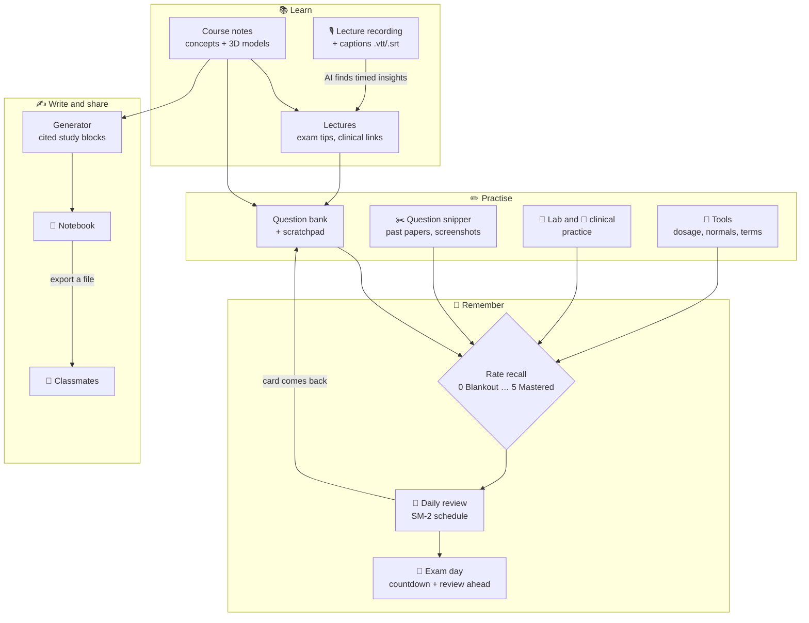
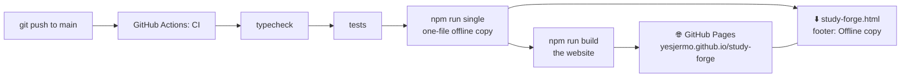
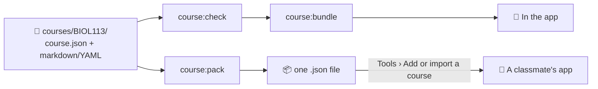
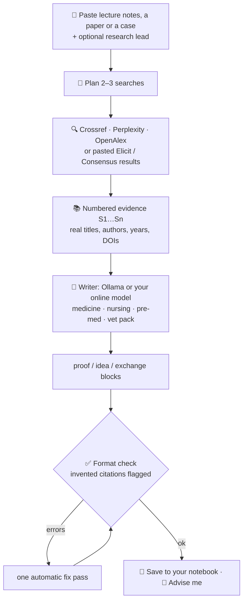
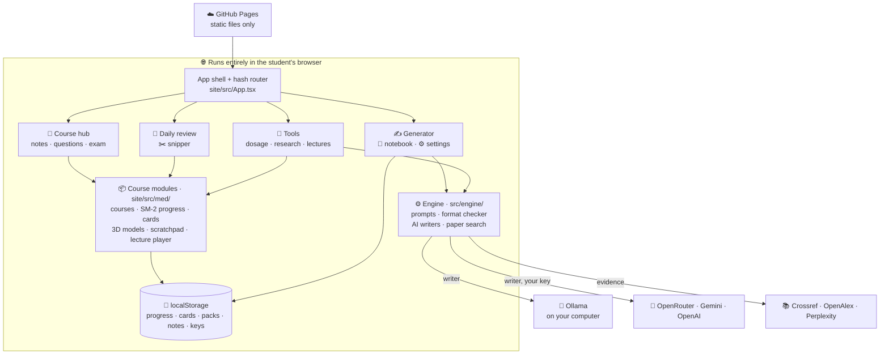
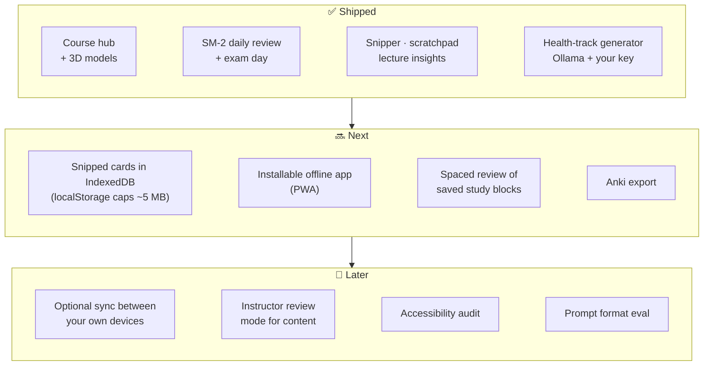

<div align="center">

# 🩺 StudyForge

**Course notes, practice questions, lab and clinical practice, and cited study blocks for medical, nursing, pre-med and pre-vet students.**

[](https://github.com/yesjermo/study-forge/actions/workflows/ci.yml)
[](https://yesjermo.github.io/study-forge/)
[](https://yesjermo.github.io/study-forge/study-forge.html)
[](LICENSE)
[](https://github.com/yesjermo/study-forge/commits/main)

[](https://nodejs.org)
[](https://www.typescriptlang.org)
[](https://react.dev)
[](https://vite.dev)
[](https://vitest.dev)
[-000000?logo=ollama&logoColor=white)](https://ollama.com)
[](#-run-it)

**[Open StudyForge →](https://yesjermo.github.io/study-forge/)**


</div>

A study site for **medical-science undergraduates** (pre-med, biomedical science, nursing pathways) at USF and other colleges: course notes, a question bank with spaced review, **lab practice** and **clinical practice**, all running in your browser. Inspired by the method of [NoobChester/course-noting](https://github.com/NoobChester/course-noting); all content is original. Not affiliated with or endorsed by any university or institution.

## 🧭 Workflow map

How the pieces fit into a study week. Everything runs in your browser; the only things that leave it are the AI requests you choose to make (to Ollama on your own computer, or to a provider you add a key for) and paper searches.



<details>
<summary>🛠️ How a change gets to the live site</summary>



</details>

## 🏥 Medical-science course hub


Three sample courses: **Human Anatomy & Physiology**, **Microbiology** and **Biochemistry**. Each has:

- **Concepts:** key ideas with formulas and clinical pearls, many with an interactive **3D model** (DNA, α-helix, haemoglobin, an enzyme–substrate complex, glucose, a sarcomere, a bacterium, a cell membrane and more) that you can drag or turn with the arrow keys
- **Lectures:** notes with exam tips, clinical links and intuitions
- **Question bank:** multiple-choice and numeric questions with hints and explanations, and a **Scratchpad** tab on every question (pen, highlighter, eraser, colours, undo; saved with the question) for sketches and side calculations. There's also a **timed exam** and a printable **revision sheet**.
- **Daily review** (`#/daily-review`): built-in SuperMemo-2 (SM-2) spaced repetition. Rate recall from 0 (Blankout) to 5 (Mastered 🎉) and each card comes back just before you'd forget it. Set your exam day to see a countdown and review ahead everything due before it.
- **Question snipper** (`#/import`): open a past exam or tutorial sheet, drag a box over a problem (and its answer, if you like), and it becomes a card in your daily review. PDFs open in the hosted site; the double-click `web/index.html` takes images and screenshots, which keeps it small. Files never leave your browser.
- **Lecture recordings:** add a recording to any lecture and play it with chapters and timed insights that follow along (the player streams with HTTP range requests, so a long recording isn't downloaded in full). **Tools > Lecture recording to insights** turns a lecture's captions into timed exam tips, clinical links and intuitions with your AI writer. Echo360 needs your university login, so export the captions (`.vtt`/`.srt`/`.txt`) and audio from Echo360, or use a direct media link; StudyForge never logs in anywhere.
- **Lab practice:** a protocol with safety notes and a tickable checklist, calculation drills that check your answer, and **lab calculators** (C₁V₁ = C₂V₂, solute mass, plate counts, hemocytometer, Beer–Lambert, Henderson–Hasselbalch)
- **Clinical practice:** a staged patient case (history → exam → tests → interpretation → diagnosis → management principles) with feedback and a score, plus an OSCE-style skill checklist with critical steps

<br clear="right">

> [!NOTE]
> For learning only, not medical advice. Cases are educational simulations with fictional patients and contain no drug doses.

### 🏫 Add your own university course

Like course-noting, each course is a folder of plain files you can write in any editor. `courses/` is git-ignored, so your notes stay on your computer.

```bash
npm run course:new -- BIOL113 "Human Anatomy"   # make courses/BIOL113/ with starter files
npm run course:check                            # find problems, with the file name
npm run course:bundle                           # add every course in courses/ to the web app
npm run course:pack -- BIOL113                  # one file to send to a classmate
```



A course folder has `course.json` plus `concepts/*.md` (add `model: dna`, `bilayer`, `virus`… to show a 3D model), `lectures/*.md`, `questions/*.md` (markdown with YAML front matter) and `labs/`, `cases/`, `skills/*.yaml`. Copy `courses.example/MEDS101` to see a complete one. In the app, **Tools > Add or import a course** imports a classmate's pack, and exports or removes the ones you've added. Imported courses live in your browser only.

### 🧰 Tools for medical, nursing and research students

Under **Tools** in the nav:

- **Dosage calculations:** D/H × Q, weight-based doses, IV pump and gravity drip rates, infusion time, with practice problems that check your answer
- **Normal values:** vital signs, electrolytes, blood counts, blood gases, glucose and lipid targets, searchable
- **Medical terminology:** 99 prefixes, roots and suffixes as flashcards with spaced review
- **Lab calculators:** dilutions, solute mass, plate counts, hemocytometer, Beer–Lambert, pH
- **Research toolkit:** turn a PICO question into a PubMed search, 2×2 statistics (sensitivity, specificity, LRs, RR, OR, NNT with 95% CIs), an evidence and appraisal guide, and AMA/APA citations from a DOI (looked up on Crossref)

Reference ranges vary between labs and textbooks; use your course's values in exams and clinical placements.

> [!IMPORTANT]
> **Current status: runs locally, no paid API keys yet.**
> - Study blocks are written by a **local model through [Ollama](https://ollama.com)** on your own computer (free and offline). Stronger models are optional: see **Choosing the AI model** below.
> - Papers are found with **Crossref**, a free scholarly index that needs no key.
> - **Perplexity, Elicit and Consensus are used manually in your own browser for now.** Search on perplexity.ai, elicit.com or consensus.app, then paste the answer, links or an exported list into the "Paste results" box. StudyForge picks out the DOIs and links and cites them.
> - The code that calls the Perplexity, Elicit, Consensus, OpenRouter, Gemini and OpenAI APIs directly is already written (from their public docs) and switches on as soon as you add a key in Settings (or in `.env` for the command-line tool). It has only been tested with mocked responses so far, not against the live services.

## 🚀 Run it

StudyForge runs entirely in the browser: no server, no account. Progress, notes and keys stay on your device.

**On your computer** (needs [Node.js](https://nodejs.org) 22.13+):

```bash
npm install
```
```bash
npm run dev
```

Then open http://localhost:5173/study-forge/. For the AI writer, install [Ollama](https://ollama.com) and run `ollama pull qwen2.5` (see **Choosing the AI model**).

**Publish it on GitHub Pages:**

1. Push this repo to GitHub.
2. In the repo, go to **Settings → Pages → Build and deployment → Source** and choose **GitHub Actions**.
3. Every push to `main` checks the code, builds the site and deploys it (`.github/workflows/ci.yml`). Classmates just open `https://<your-username>.github.io/study-forge/`.

**One file to double-click or send to a classmate:**

```bash
npm run single
```

It writes **`web/index.html`** (about 1.4 MB, everything inlined). Build outputs aren't kept in git, so run it once after cloning; on GitHub Pages the same file is offered by the footer link **Offline copy**. A page opened from a file works for everything except Ollama (Ollama only accepts file pages if you allow every website) and PDF snipping (screenshots still work). Don't open `site/index.html` directly: it's source code for Vite and shows a blank page.

### 🖥️ Previewing in VS Code

- **One click:** open the **Run and Debug** panel (⇧⌘D), choose **Preview web edition (Edge)** (or Chrome), and press ▶. VS Code starts the dev server and opens `http://localhost:5173/study-forge/`.
- **Inside VS Code:** run `npm run dev`, then ⇧⌘P → **Simple Browser: Show** and paste `http://localhost:5173/study-forge/`.
- **Live Server extension:** run `npm run single` once, then right-click **`web/index.html`** → **Open with Live Server**. Because Live Server serves over `http://localhost`, Ollama works there too.

### 🦙 Using Ollama from the published site

A website can only talk to Ollama on your computer if you allow it. Do this once, then restart Ollama:

```bash
launchctl setenv OLLAMA_ORIGINS "https://<your-username>.github.io"
```

On Windows or Linux, set the environment variable `OLLAMA_ORIGINS=https://<your-username>.github.io` instead. Use Chrome, Edge or Firefox; Safari blocks secure pages from calling `http://localhost`. Chrome may ask once for permission to access devices on your local network. The Settings page shows the exact command for its address.

## 📦 What's inside

### ✍️ Generator: cited study blocks



- Four packs for health students: **medicine** (presentation → differential → workup → treatment rationale), **nursing** (assessment → priority problem → interventions with rationales → evaluation, NCLEX-style), **pre-med** (basic-science mechanisms, MCAT-style) and **pre-vet / veterinary** (signalment → diagnosis, with species differences)
- The writer may only cite `[S#]` sources from the evidence list. The format checker flags any tag or DOI that wasn't retrieved, so invented citations are easy to spot.
- "Check my blocks" lints blocks you wrote by hand, entirely in the browser.

### 📓 Study Hub notebook

- **Post types:** problem to solve, proof to check, idea / project, study pack, discussion
- **Tracks:** medicine, nursing, pre-med, pre-vet, biomedical science, biology, chemistry, public health, pharmacy and allied health, plus optional course codes
- **Replies** are marked as a solution, a critique / stress test or a comment, and you can accept the best solution.
- Posts can contain `$math$` and `:::` blocks, which render with the format check
- Posts stay in your browser. To swap with classmates, export your posts to a file and they import it (course packs work the same way).

## ⌨️ Command-line tools

```bash
npm run cli -- providers
npm run cli -- generate --pack premed examples/oxygen-lecture.txt --out pack.md
npm run cli -- generate --pack nursing notes.txt --evidence pasted-from-elicit.txt
npm run cli -- lint pack.md
```

The CLI runs in Node, so it can also use Elicit and Consensus (their APIs block web pages); put keys in `.env` (see below).

## 🔎 Research lead and "Advise me"

- **Research lead** (optional box on the generator): write your question, thesis or angle, e.g. "Does early mobilisation reduce pressure injuries in ICU patients?". Searches are planned around it, and the blocks focus on it. If the evidence doesn't support it, the Open Questions list says so.
- **Advise me** (on a generated pack) and **Get advice** (on any notebook post) review your work in four parts: **Sources** (unused, single, unverified or web-only sources), **Thesis** (is the claim clear, scoped and supported, and does it answer your lead), **Idea** (gaps, risks, how to test it) and **Next searches** (queries to run; on the generator, one click makes a search your next research lead).
- Instant automatic checks appear first; the AI advice follows from your chosen writer. The advisor never invents sources: any line that cites an `[S#]` that isn't in your work or its evidence is removed.

## 🤖 Choosing the AI model

**Ollama is the free default.** It runs a model on your own computer, so nothing leaves it. Pick the model in Settings; suggestions:

| Model | Pull it with | Notes |
|---|---|---|
| Qwen 3 | `ollama pull qwen3` | good all-rounder for a laptop |
| Qwen 2.5 | `ollama pull qwen2.5` | smaller and faster (the current default) |
| gpt-oss | `ollama pull gpt-oss` | OpenAI's open model, needs about 16 GB of memory |
| Gemma 3 | `ollama pull gemma3` | Google's open model |
| DeepSeek R1 | `ollama pull deepseek-r1` | reasons step by step, slower |
| Kimi K2, gpt-oss 120B, DeepSeek V3.1 | `ollama signin`, then use `kimi-k2:1t-cloud`, `gpt-oss:120b-cloud` or `deepseek-v3.1:671b-cloud` | big models on Ollama's cloud, free with hourly limits |

**Online models with your own key** (optional): **OpenRouter** gives one key for GPT, Sonnet, Gemini, Qwen, Kimi and DeepSeek, and models ending in `:free` cost nothing. **Google Gemini** has a free tier. **OpenAI** is pay as you go. Settings also accepts any other OpenAI-compatible address (for example Moonshot for Kimi or Alibaba Cloud for Qwen). Model names change often, so the suggestions are a starting point and any model id works.

## 🔑 API keys (all optional)

Each student adds their own keys in **Settings**. They're saved only in that browser and go straight to each provider.

| Key | What it enables | Cost |
|---|---|---|
| OpenRouter | Writer: GPT, Sonnet, Gemini, Qwen, Kimi, DeepSeek… | `:free` models cost nothing; others pay per use |
| Google Gemini | Writer | free tier with daily limits |
| OpenAI | Writer (GPT) | pay per use |
| Perplexity | Perplexity Sonar academic web search | pay per use |
| OpenAlex | OpenAlex search (abstracts) | free key |
| Elicit, Consensus | Paper search, **command-line tool only** (their APIs block web pages; in the browser, paste their results instead) | Elicit Pro; Consensus free plan has 30 calls/month |

For the command-line tool, copy `.env.example` to `.env.local` and fill in what you have; `npm run cli -- providers` shows which are active.

## 🏗️ Architecture

StudyForge is a static single-page app: no server and no database. GitHub Pages serves the files, and everything else happens in the student's browser.



| Layer | Where | What it does |
|---|---|---|
| App shell | `site/src/App.tsx`, `router.ts` | Hash routes like `#/c/<course>/questions/<id>`, so the site works on GitHub Pages and from one file |
| Pages | `site/src/med/pages/`, `site/src/pages/` | Course hub, daily review, snipper, tools, generator, notebook, settings |
| Course modules | `site/src/med/` | Course data and packs, SM-2 progress, snipped cards, 3D models, scratchpad, lecture player, nursing and research calculators |
| Engine | `src/engine/` | Block format (prompts, parser, validator), generation pipeline, advisor, AI writers (Ollama, OpenAI-compatible), paper search |
| Storage | the browser's `localStorage` | Everything a student saves stays on their device; export/import files move it elsewhere |
| Build | `site/vite.config.ts`, `.github/workflows/ci.yml` | Vite builds the site and the one-file copy; CI tests, then publishes to Pages |
| CLIs | `src/cli.ts`, `scripts/course.ts` | Generate and lint packs from the terminal; create, check, bundle and pack course folders |

## 🗺️ Roadmap



The spaced-repetition and course-space ideas build on [NoobChester/course-noting](https://github.com/NoobChester/course-noting). StudyForge reuses its ideas, not its code.

## 📁 What's in the repo

| Folder | What it is |
|---|---|
| `site/` | The app (Vite + React): course hub, tools, generator, notebook |
| `src/` | The engine (`src/engine/`: prompts, format checker, AI writers, paper search), shared components and the generator CLI |
| `tests/` | Vitest tests |
| `courses.example/` | An example course folder; copy it into `courses/` (kept off GitHub) to make your own |
| `examples/` | An example lecture and study pack for the generator CLI |
| `scripts/` | The course-folder CLI (`npm run course:*`) |
| `.github/` | The CI and Pages workflow, issue templates, and the GIFs in this README (`.github/media/`) |

## 🛠️ Development

```bash
npm run typecheck && npm test && npm run build
```

Format rules (v2): IDs look like `MED-SEPSIS-0001` (prefixes `MED NUR PRE VET`), blocks are never nested, attributes are double-quoted, and `$$` equations have blank lines around them. Sources are `[S#]` evidence tags, the input, or `[UNVERIFIED — search: …]`. MEDICINE, NURSING and VETERINARY proof blocks end with an "Educational use only" line.

See [CONTRIBUTING.md](CONTRIBUTING.md). MIT licensed.
